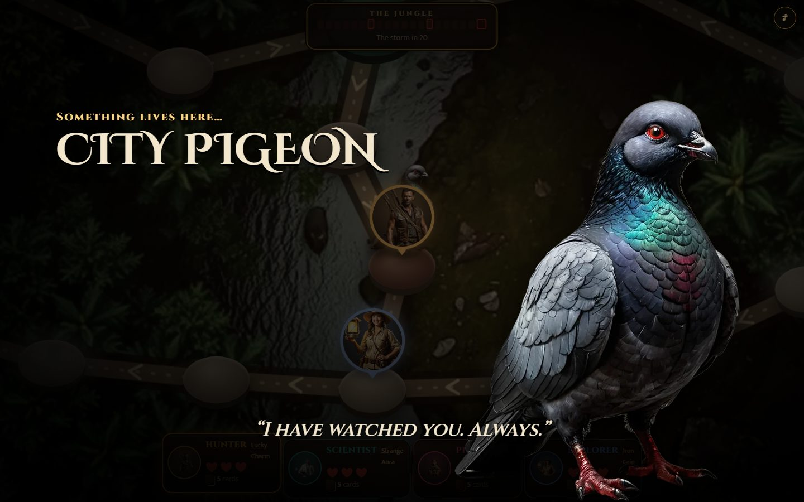
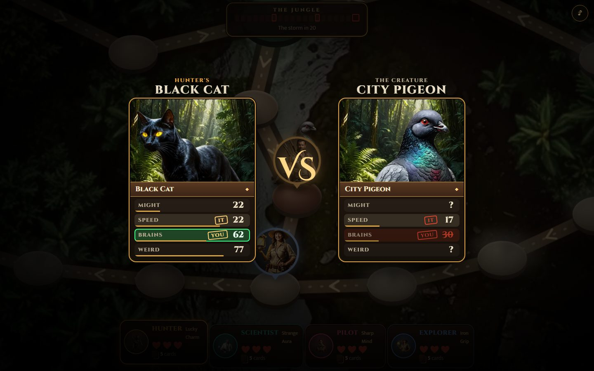
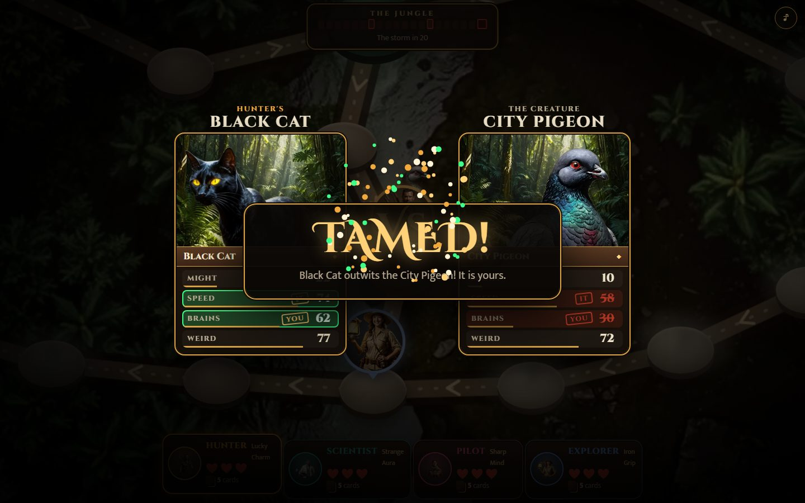
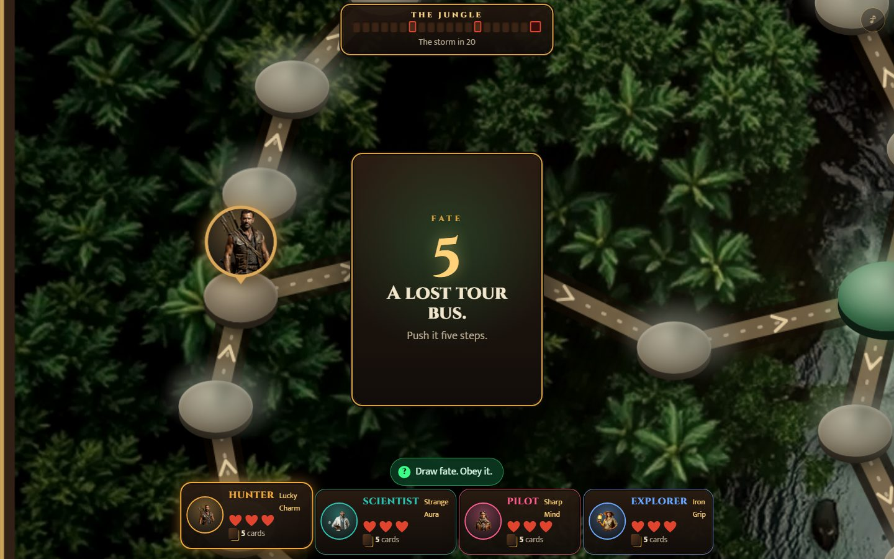
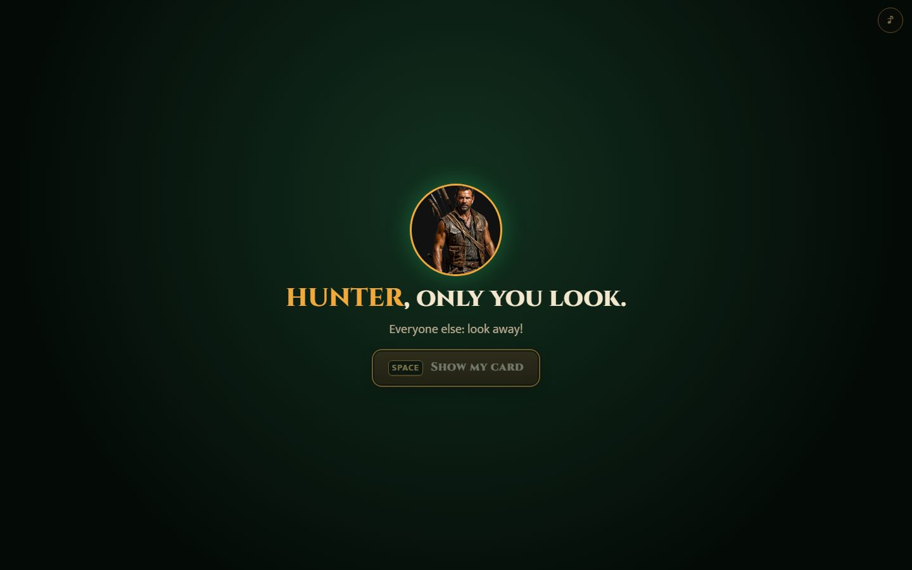
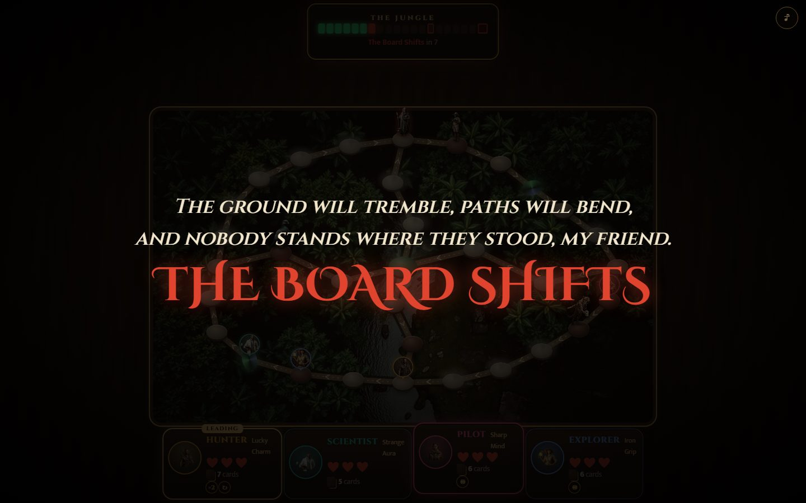
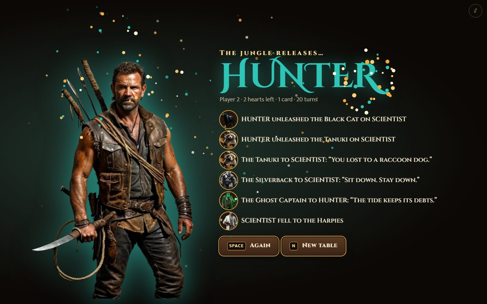

<div align="center">

# JUNGLEE

### The Cursed Game

**A Jumanji-style party game for 2 to 4 friends around one laptop.**
Draw a fate card. Step into the fog. Duel whatever lives there, trump-card style.
Three hearts. No healing. Last one alive wins.

### [▶ Play it now in your browser](https://shv27.github.io/junglee/)

Free · no sign-up · no download · about 10–15 minutes a match



</div>

---

## The game in one breath

An antique board game wakes on your table. Every turn it deals you a **fate card** and you must obey it: walk into the fog,
fall through a portal, steal a friend's card, or **unleash a beast on them**. Somewhere in the fog, something is waiting.

When a creature bursts out, you fight it the way you fought at school with trump cards: your **blind top card** against a
creature you can only *see*. Pick **MIGHT, SPEED, BRAINS or WEIRD** in secret — it picks too — and both numbers are counted up
side by side. Win both and it joins your deck. Lose, and a heart shatters.

The **Jungle Meter** fills a notch every turn. Twice a match, the drums rise, a verse appears, and **the table flips**. When the
meter is full, **the storm** comes — and only a win will save you. The fallen don't leave the table: they **become the jungle**.

## How to play

| | |
|---|---|
| **1. Draw a fate card** | Move, portal, steal, unleash, trap or swap. Obey it. |
| **2. Step into the fog** | You see one step ahead. At a fork, you see nothing at all. |
| **3. Read the beast** | How a creature *enters* tells you what it's good at: a slam, a streak, a stare, a glitch. |
| **4. Pick in secret** | Pass the laptop: "only you look". Pick a stat. It picks too. |
| **5. Best of both** | Win both rows: **tamed**. Lose both: **a heart**. One each: it stays, and grows. |
| **6. Survive** | Three hearts, never healed. The last hero standing walks out of the game. |

<p align="center">
  
  
</p>

<p align="center">
  
  
  
</p>

## What's inside

- **45 painted creatures** from legends and jungles all over the world — Medusa, the Kraken, Fenrir, the Sphinx, the Makara and
  the Yali, a Dodo, a Lost Tourist, a very stern Grandmother — each with a line on the way in and a gloat on the way out.
- **Heroes dealt by luck** (Explorer, Hunter, Pilot, Scientist), each with a power that is re-dealt whenever the table flips.
- **Items** you earn by taming: Peek at the creature's real card, Redraw your blind card, or Double your stat.
- **Nasty, fair fun:** unleash beasts, hide traps, steal cards, swap places — but nobody is hit twice in a row.
- **One device, no accounts:** a hot-seat game designed for a laptop on a table. Keys and taps both work.
- **Procedural drums** that speed up as the tension rises, and go silent the moment before every reveal.

<p align="center">
  
</p>

## Run it yourself

```bash
npm install
npm run dev          # play locally
npm run check        # type-check + unit and property tests
npm run e2e          # real-browser journeys on laptop, tablet and phone
node scripts/sim7.ts 2000 4   # the balance gate: length, luck vs skill, duel odds
```

Built with TypeScript, Vite and the Web Animations API — no game engine. The rules are a small deterministic generator
(`src/game/v7`) that the presentation (`src/play`) plays back one beat at a time.

## Credits

All creature, hero and scene art was generated for this game with free, openly licensed models (FLUX.1 [schnell], Apache-2.0;
Juggernaut XL, CreativeML Open RAIL++-M), picked and cut out by hand, and is released under **CC0**. Every file is listed in
[`assets/LICENSES.json`](assets/LICENSES.json). Fonts: Cinzel and Mukta (SIL Open Font License). Sound is synthesized in the browser.
